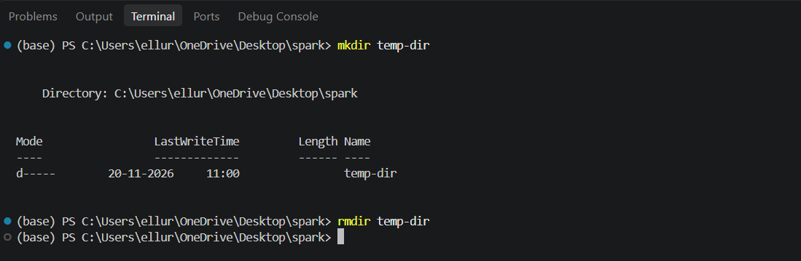
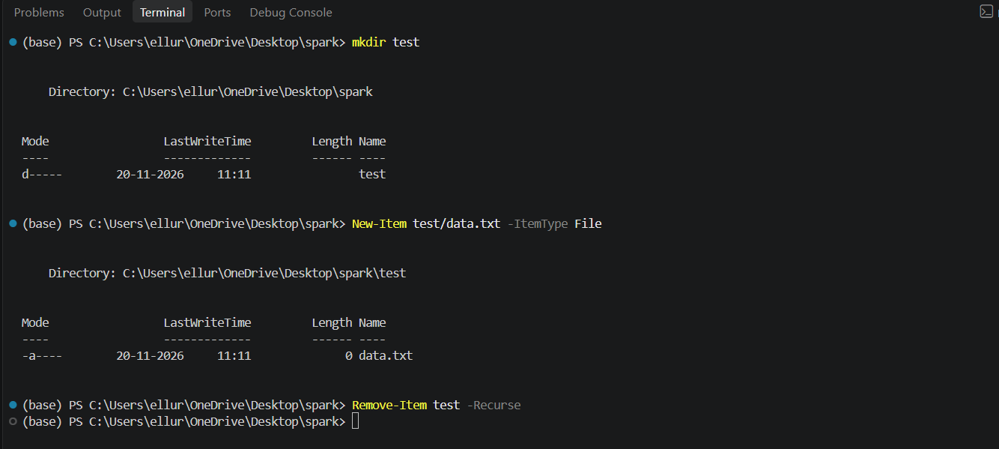
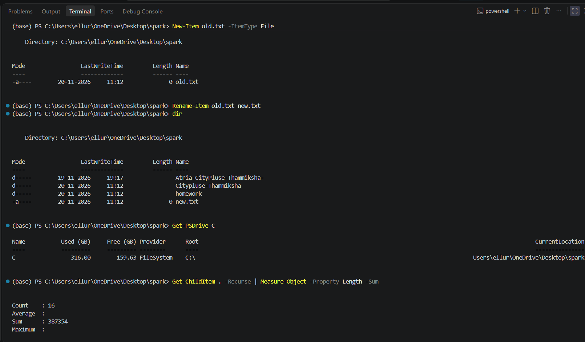
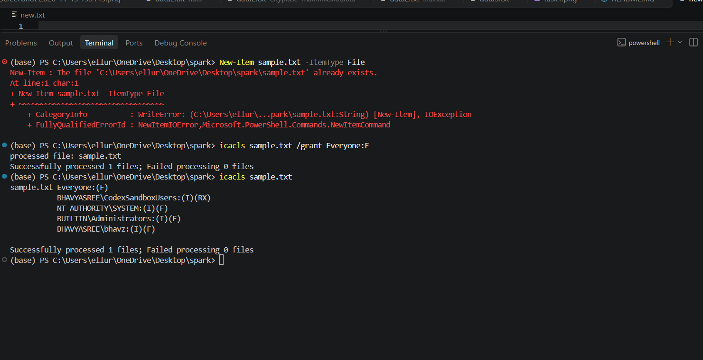
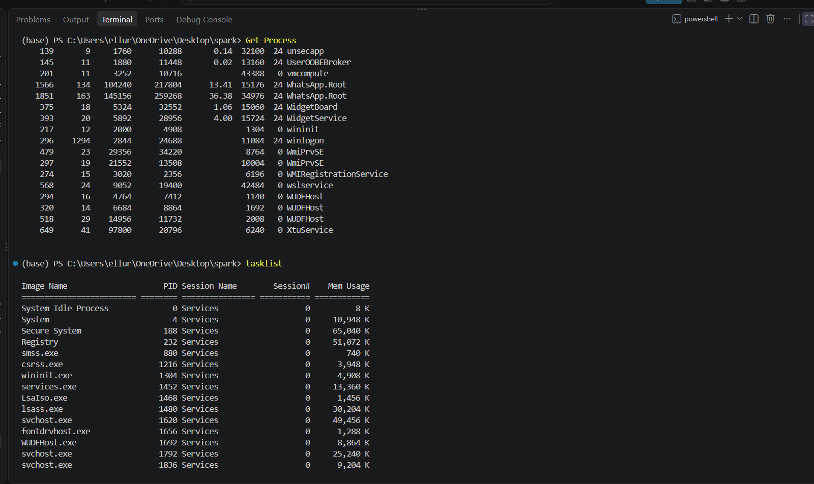

# Citypluse-Thammiksha

## Introduction

This repository contains practical command-line exercises completed using **Windows PowerShell**. The exercises cover directory management, file deletion, file renaming, disk usage, file permissions, and process management.

## Task 1: Remove Directories

### Objective
Create a directory and then remove it.

### Commands Used

powershell
mkdir temp-dir
rmdir temp-dir

### Explanation
- `mkdir temp-dir` creates a directory named `temp-dir`.
- `rmdir temp-dir` removes the empty directory.

### Screenshot

---

## Task 2: Remove Files and Folders Recursively

### Objective
Create a folder containing a file and remove the folder along with its contents.

### Commands Used

powershell
mkdir test
New-Item test/data.txt -ItemType File
Remove-Item test -Recurse

### Explanation
- `mkdir test` creates a directory named `test`.
- `New-Item test/data.txt -ItemType File` creates a file named `data.txt` inside the directory.
- `Remove-Item test -Recurse` deletes the directory and everything inside it.

### Screenshot

---

## Task 3: Rename Files and Check Disk Usage

### Objective
Create and rename a file, list directory contents, and check disk usage.

### Commands Used

powershell
New-Item old.txt -ItemType File
Rename-Item old.txt new.txt
dir

To check available disk space:

powershell
Get-PSDrive C

To calculate the total size of files in the current directory and its subdirectories:

powershell
Get-ChildItem . -Recurse -File | Measure-Object -Property Length -Sum

### Explanation
- `New-Item` creates a new file named `old.txt`.
- `Rename-Item` renames `old.txt` to `new.txt`.
- `dir` displays the files and folders in the current directory.
- `Get-PSDrive C` displays disk information for the C drive.
- `Get-ChildItem` lists files recursively, and `Measure-Object` calculates their total size in bytes.

### Screenshot

---

## Task 4: File Permissions

### Objective
Change and check file permissions.

### Commands Used

powershell
New-Item sample.txt -ItemType File
icacls sample.txt /grant Everyone:F
icacls sample.txt

### Explanation
- `New-Item sample.txt -ItemType File` creates an empty file named `sample.txt`.
- `icacls sample.txt /grant Everyone:F` grants the Everyone group full control over the file.
- `icacls sample.txt` displays the file's permission information.

**Note:** `icacls` is a Windows command used to manage file access permissions.

### Screenshot

---

## Task 5: List All Running Processes

### Objective
Display the processes currently running on the system.

### Commands Used

powershell
Get-Process

powershell
tasklist

### Explanation
- `Get-Process` displays currently running processes using PowerShell.
- `tasklist` displays a list of running processes in Windows.

### Screenshot

---

## Conclusion

Through these five tasks, I practised basic command-line operations using Windows PowerShell. I learned how to:

1. Create and remove directories.
2. Delete files and folders recursively.
3. Rename files and check disk usage.
4. Manage and view file permissions.
5. List currently running processes.

These exercises helped me understand basic file management, system administration, and process management commands.

---

**Repository:** Citypluse-Thammiksha  
**Platform:** Windows PowerShell